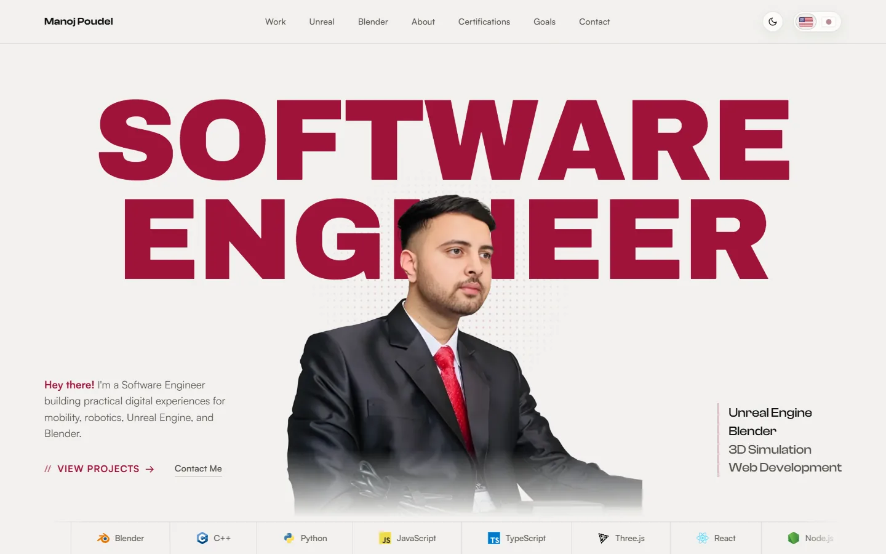

<h1 align="center">Manoj Poudel · Portfolio</h1>

<p align="center">
  Software Engineering · Real-time 3D · Web Development<br>
  Based in Tokyo, Japan · Available in English and Japanese
</p>

<p align="center">
  <a href="https://pro-portfolio-mocha.vercel.app/"><strong>View live portfolio ↗</strong></a>
  &nbsp; · &nbsp;
  <a href="#selected-work">Explore the projects</a>
  &nbsp; · &nbsp;
  <a href="https://www.linkedin.com/in/manojpoudel0429/">Connect on LinkedIn</a>
</p>

[](https://pro-portfolio-mocha.vercel.app/)

<p align="center"><sub>Desktop landing page · Light theme · Captured from the live website</sub></p>

## Overview

This is the source for my personal portfolio: a collection of web applications,
3D asset tools, and Unreal Engine projects, alongside my professional experience,
education, and certifications.

The site brings those different disciplines into one consistent experience.
Large editorial typography introduces the work; project previews, concise
descriptions, and links provide a closer look at what each project does.

Built with **HTML, CSS, and vanilla JavaScript**, the portfolio runs as a static
site with no framework and no dependencies. The page is written as small source
files in `src/`; a ~70-line Node script (`build.mjs`) stitches them into a single
fast `index.html` with its critical CSS and JavaScript inlined. The applications
and tools it showcases are separate projects.

## Selected work

| Project | Focus | Explore |
| --- | --- | --- |
| **GLB Insight — Analyzer** | Used by my team at work to check 3D model geometry, textures and file size before Unreal Engine import, with exportable PDF reports. | [Source code](https://github.com/manojpoudel9256/GLBAnalyzer) |
| **GLB Forge — Optimizer** | Mesh simplification and texture downscaling for AI-generated models (typically ~1M → ~100k triangles, ~20 MB → 4–5 MB) with a before/after viewer. | [Source code](https://github.com/manojpoudel9256/GLBOptimizer) |
| **Everest Travel Experience** | A personal concept: a bilingual marketing site for Himalayan expeditions. | [Live website](https://travel-site-delta-five.vercel.app/) |
| **Budget Tracker / 家計簿** | A calm, bilingual budget book for life in Japan: on-device receipt and salary-slip scanning (Tesseract.js, PDF.js, optional Gemini), a budget assistant whose numbers are computed on-device, installable and offline; rebuilt from my college PHP version and in weekly use. | [Live app](https://budget-tracker-v2-gamma.vercel.app/) |
| **Salary Tracker App** | Bilingual salary and remittance tracker for working in Japan: payslip/receipt scanning with Gemini, an AI money assistant whose numbers are computed on-device (100+ tests), installable and offline; in daily use by me and a friend. | [Live app](https://salary-tracker-v3-six.vercel.app/) |
| **Darts Game** | A third-person Unreal Engine game exploring aiming, scoring, and player interaction. | [Full video](https://www.linkedin.com/posts/manojpoudel0429_unrealengine-ue5-gamedev-activity-7488763663969865729-xFQf) |
| **Warehouse Simulation** | An Unreal Engine simulation featuring conveyors, storage racks, and robotic equipment. | [Full video](https://www.linkedin.com/posts/manojpoudel0429_unrealengine-ue5-digitaltwin-activity-7505517491381489664-4iHa) |

## Experience and design

- **English and Japanese:** translated interface and project descriptions, with a saved language preference.
- **Light and dark themes:** coordinated surfaces, typography, and accents, with a saved theme preference.
- **Dedicated phone layouts:** a mobile type scale, compact cards, a 2 × 2 certification grid, 44px touch targets, and a navigation drawer with animated section icons.
- **On-demand video:** short 1080p Unreal Engine previews load after interaction. Touch phones use optimized MP4; desktop retains WebM-first playback with an MP4 fallback.
- **Blender Work:** two original GLB assets with AI-styled WebP previews and an on-demand Three.js inspector. Orbit, zoom, pan, switch lighting, view wireframes, and inspect measured geometry and file statistics.
- **Project and photo viewers:** each project explains the problem, what I did and the result; dialogs trap focus, return it on close and always open at the top.
- **Considered motion:** a code-rendered `hello` introduction (once per session, skippable), scroll reveals, and full reduced-motion handling.
- **Accessible:** keyboard-operable cards and dialogs, a skip link, visible focus for keyboard users only, and AA colour contrast in both themes.
- **Direct contact:** email, social profiles, and a contact form delivered through Formspree.

The visual system combines a burgundy hero with champagne-cream and metallic gold
content sections. Archivo Black and Playfair Display establish the hierarchy, supported
by Satoshi body text and IBM Plex Mono labels. Phone refinements are isolated
from the desktop composition.

## Implementation

| Layer | Implementation |
| --- | --- |
| Structure and content | Section partials in `src/partials/`, project data in `src/scripts/project-modal.js`, EN/JA dictionaries in `src/scripts/i18n.js` |
| Presentation | CSS custom properties, Grid and Flexbox; render-critical CSS is inlined, below-the-fold section styles load asynchronously |
| Interaction | Vanilla JavaScript for navigation, themes, translation, filters, dialogs, and playback |
| Animation | GSAP, ScrollTrigger and Lenis, loaded after the page is idle; inline CSS/JS for the intro and menu icons |
| Media | Responsive WebP images (`srcset`), self-hosted WOFF2 fonts, and on-demand WebM/MP4 previews |
| 3D inspection | Self-hosted Three.js r180, GLTFLoader, OrbitControls, and studio environment lighting; loaded only on request |
| Contact delivery | Formspree |
| Build | `node build.mjs` expands `@include` markers in `src/index.html` into `dist/index.html` and copies the static files; no dependencies |
| Hosting | Vercel runs the build and serves `dist/` (`vercel.json`: build, cache headers; `.vercelignore`) |
| Verification | Node's built-in test runner and optional Playwright browser checks |

GSAP, ScrollTrigger and Lenis load from public CDNs; the page works without them
(motion is optional). All fonts and portfolio media are served from this
repository. The contact form requires Formspree connectivity.

## Run locally

With Git, Node.js 18+ and Python 3 installed:

```bash
git clone https://github.com/manojpoudel9256/pro-portfolio.git
cd pro-portfolio
node build.mjs                                   # writes dist/
python -m http.server 4173 --bind 127.0.0.1 --directory dist
```

Open **[localhost:4173](http://localhost:4173/)**. Re-run `node build.mjs` after
editing anything in `src/` (files outside `src/` are copied as they are).
`node build.mjs --check` verifies every `@include` without writing files.

For layout work, skip the opening animation with `?nopreload=1`. Add
`&theme=light` or `&theme=dark` to inspect a specific theme:

```text
http://localhost:4173/?nopreload=1&theme=light
```

## Repository guide

```text
.
├── build.mjs                  # Builds dist/: expands src/index.html, copies static files
├── src/                       # Page source (stitched into one index.html at build time)
│   ├── index.html             # Page template: <head>, layout and @include markers
│   ├── partials/              # top-nav, mobile-menu, intro, project-modal, blender-inspector
│   │   └── sections/          # home, work, unreal-projects, blender-work, about-me,
│   │                          # future-goals, contact
│   ├── styles/                # Inlined CSS: golden-theme, mobile, mobile-menu, intro
│   │   └── base/              # Foundation, navigation, hero, work, about, credentials,
│   │                          # education, contact/footer, responsive
│   └── scripts/               # Inlined JS: theme-init, intro, page, project-modal (project
│                              # data), image-viewer, i18n (EN/JA), clock, scroll, motion
├── mobile-menu.js             # Mobile navigation drawer: focus and scroll handling
├── unreal-projects.css / .js  # Unreal Engine cards and media lifecycle
├── blender-work.css / .js     # Blender gallery, translations, and inspector dialog
├── blender-viewer.js          # Lazy-loaded Three.js renderer and resource cleanup
├── future-goals.css           # Future Goals section
├── manifest.json              # App metadata and home-screen icons
├── vercel.json / .vercelignore# Build + cache headers; files kept out of the deployment
├── robots.txt / sitemap.xml   # Search-engine metadata
├── docs/                      # Design notes, mobile/Blender verification, improvement plan
├── fonts/                     # Self-hosted typefaces and mobile font instances
├── assets/
│   ├── icons/                 # Favicons and app icons
│   ├── logos/                 # Branding, technology, and certification marks
│   ├── images/                # Portraits, projects, education; archive/ and exports/
│   │                          # hold source files and are not deployed
│   └── videos/unreal-engine/  # Optimized project previews
└── tests/                     # Interaction tests and optional browser checks
```

To update project content, edit the `PROJECTS` object in
`src/scripts/project-modal.js`, the card in `src/partials/sections/work.html`, and the
English/Japanese text in `src/scripts/i18n.js`. Phone styling lives in
`src/styles/mobile.css` (inlined into `<style id="mobile-refinements" media="(max-width: 768px)">`).
Update the Formspree action and personal links if adapting the site.

Further documentation:

- [Asset organization and naming](assets/README.md)
- [Improvement plan and progress log](docs/PORTFOLIO-100-PLAN.md)
- [Design decisions and project artwork](docs/DESIGN-REFINEMENT.md)
- [Mobile refinements and browser verification](docs/MOBILE-REFINEMENT.md)
- [Video encoding and delivery](assets/videos/unreal-engine/README.md)
- [Unreal Engine cover artwork](assets/images/projects/unreal-engine/ARTWORK.md)
- [Blender showcase and browser verification](docs/BLENDER-WORK.md)
- [Original GLBs and measured statistics](assets/models/blender/README.md)
- [Blender preview artwork](assets/images/projects/blender/ARTWORK.md)
- [Mobile font instances](fonts/MOBILE-FONTS.md)
- [Self-hosted Google Fonts and licence](fonts/GOOGLE-FONTS.md)

## Verification

Check that the page source builds, then run the interaction tests with Node.js:

```bash
node build.mjs --check
node --test --test-isolation=none tests/mobile-menu.test.cjs tests/unreal-projects.test.cjs
```

These cover navigation focus, scroll locking, keyboard behavior, deferred media
loading, format selection, playback errors, and language updates.

Optional Playwright checks capture each section and inspect overflow, touch
targets, dialogs, and video playback. The mobile review includes the iPhone 14
Pro Max portrait viewport, smaller phone widths, English/Japanese, and both
themes. Desktop regression checks compare screenshots and element layout at
1024, 1440, and 1920px. See the [verification instructions](docs/MOBILE-REFINEMENT.md#run-the-optional-browser-checks).
Browser emulation complements physical-device testing; it does not replace it.

## Deployment

The repository can be served by a static host. For Vercel:

| Setting | Value |
| --- | --- |
| Framework preset | Other |
| Root directory | Repository root |
| Build command | `node build.mjs` (set in `vercel.json`) |
| Output directory | `dist` (set in `vercel.json`) |

`vercel.json` sets long-lived caching for fonts and a one-day cache for assets.
`.vercelignore` keeps documentation, tests, scripts and source-only images
(`assets/images/archive/`, `assets/images/exports/`) out of the public deployment.
No server process or environment variables are required by the portfolio itself.

**Live:** [pro-portfolio-mocha.vercel.app](https://pro-portfolio-mocha.vercel.app/)

## Connect

I'm interested in practical software, real-time 3D, and opportunities to build
useful products with thoughtful teams.

[LinkedIn](https://www.linkedin.com/in/manojpoudel0429/) ·
[GitHub](https://github.com/manojpoudel9256) ·
[Email](mailto:poudelmanoj604@gmail.com)

---

<sub>Designed and developed by Manoj Poudel · Tokyo, Japan</sub>
